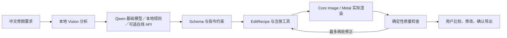

# LumaStudio Edge AI · Mac 0.3.0 开发状态

本轮按用户确认的范围交付 **Mac 应用和可复现训练流水线**。用户当前没有 GPU 训练服务器；1.5B／3B 专业学生模型训练、蒸馏和偏好优化不作为已经完成的成果。iPad 后续开发与验收暂停，已有代码保留。

2026-11-12 的 0.3.0 新增可选在线模型 API（Chat Completions／Responses）、系统钥匙串设置、真实 MetalPetal GPU 美颜、Mac Speech 输入、小智 MCP WebSocket 及有认证的本机语音 HTTP／stdio 接口。swift-collections 用于有界语音去重记录。当前 60 项 Swift 检查和 3 项 stdio 协议检查通过；真实照片的暖调／曝光／美颜叠加偏色回归通过。在线与 MCP 使用本机协议服务，真实付费服务、小智硬件与真人语音质量未验收。详细配置和准确边界见 [INTEGRATIONS.md](INTEGRATIONS.md)。

2026-11-11 的 0.2.2 增加原生 Agent 处理过程页面，使用实际执行事件展示分析、方案校验、渲染、检查与保存，支持轮次预览、原图对照和采用版本。此次重新执行 46 项 Swift 检查，0 失败，含真实样片、原生 Qwen 和执行事件记录；专业训练范围没有变化。详情见 [AGENT_PROCESS.md](AGENT_PROCESS.md)。

2026-11-11 的 0.2.1 更新集中在 Mac 工作区：紧凑导航、大画布、四类调整面板、真实 LUT 缩略图、前后对比、缩放、查找／RAW 筛选和配方批量入口。Mac Release 与实际操作检查通过，2 张验证照片批量导出完成、0 失败，单张导出为 2615 × 3269 JPEG，原片哈希保持不变。没有修改共享图像算法或训练模型；此前的 45 项 Swift／6 项训练检查仍是 2026-11-10 的基线证据。详情见 [UI_WORKSPACE.md](UI_WORKSPACE.md)。

## 已接入应用的工作流

- Mac 原生拍摄、修图、批量三个工作页，新增自然语言输入、编辑方案、逐轮记录、撤销／重做和本地风格记忆。
- `EditRecipe v1` 与 JSON Schema：拒绝未知字段／工具、越界数值、非法曲线和局部区域 ID；模型不能执行脚本或动态代码。
- 实际图像工具：曝光、对比、亮部／暗部、色阶、白平衡、自然饱和度，六种 LUT、参考色彩迁移、HSL、RGB 曲线和分离色调。JSON 配方可表达高级色彩调整；当前通用基础模型采用较小的生成格式，主要规划基础参数、滤镜、美颜和局部调整。
- 人脸、皮肤、人物、背景可用于局部调整。人物／背景来自 Apple Vision 人物分割；皮肤默认是人脸关键点与传统算法。**未安装或伪造天空、头发专用模型。**
- 自然美颜实际使用 MetalPetal 高通平滑、纹理恢复和温和肤色优化，结合 Vision／传统皮肤蒙版；不等同于训练好的商业精修网络。当前没有痘痘／痣语义区分、液化、五官重塑或生成式消除。
- Evaluator 测量高光溢出、暗部丢失、纹理变化、肤色偏移与已识别的指令方向；使用确定性指标，**没有训练好的视觉审美评价器**。局部语义和审美仍需用户看图确认。
- 自动修正最多两轮，可关闭。保存每一轮配方、执行工具、检查结果和预览，最后由用户决定导出。
- 全尺寸导出与批量继续使用原有安全管线：RAW／JPEG 原片保留，现有目标拒绝覆盖，预览不替代最终输出。

## 当前语言模型的真实身份

已安装本机原有的 **Qwen2.5-Coder-1.5B-Instruct Q4_K_M**，986,048,576 字节，SHA256：

`29d8c98fa6b098e200069bfb88b9508dc3e85586d20cba59f8dda9a808165104`

它在本地模式通过 llama.cpp 在应用进程内加载，不调用 Ollama 服务、Python 或远端推理；在线模式由使用者选择和配置。它是通用基础模型，**没有接受 LumaStudio SFT 或蒸馏**。它可能生成语法合法但不合适的参数，因此还需要指令约束、评价、规则降级和用户确认。不能据此宣称达到 Jarvis 的专业理解和审美能力。

模型包清单记录版本、SHA256、许可、平台、最低内存、精度、输入输出协议、训练状态和基准状态；支持本地安装、版本切换／回滚和卸载。GGUF、单文件 Core ML 和 `.mlpackage` 都进行内容校验；皮肤模型需符合 `LumaStudio skin-probability v1`。专用 Vision／Evaluator 模型的完整运行适配仍未接入，界面会显示这一点。

默认模型目录为 `~/Library/Application Support/LumaStudio/ModelPackages`。模型加载／输出检查失败或设备资源不足时使用本地规则与 Vision。设备面板显示实测内存、Metal 设备与内存压力，不宣称单独检测或使用了 Neural Engine。

## 训练流水线已做什么

代码覆盖教师适配、训练专用远端教师接口、图像预处理、授权／哈希校验、真实渲染、质量筛选、按原图隔离的数据划分、SFT、响应／工具轨迹训练、对齐词表的 logit 蒸馏、特征投影损失、DPO、独立分割／评价器训练、量化、Core ML 转换和模型包生成。

已执行的范围：

1. 同一张有明确 CC0 授权的真实 G9 RAW，3 条指令，实际生成配方、渲染和评价；3 条通过当前指标门槛，原图未变。它们明确标为规则流程基线，**可用于正式学生训练的样本数为 0**。
2. 训练侧 6 项检查通过，覆盖授权哈希、协议、数据隔离、蒸馏梯度和小网络更新。
3. 使用随机初始化的微型测试模型，在本机 MPS 上执行 SFT 入口、2 次优化更新与适配器保存。它是程序冒烟测试，**不是 1.5B／3B 学生模型，也不提供摄影质量证据**。

尚未执行：正式多模态教师数据生成、大规模高质量数据集、1.5B／3B SFT、正式蒸馏、人工偏好优化、专业分割／美颜／评价模型训练、FP16／BF16／INT8／INT4 同任务对比、Core ML 数值等价与真机性能验收。详见 [Training 使用说明](../Training/README.md) 和 `Artifacts/training-preflight.json`。

## 与 Jarvis 的关系及进度估算

已检查 [JarvisArt 许可](https://github.com/LYL1015/JarvisArt/blob/main/LICENSE) 和 [JarvisEvo 许可](https://github.com/LYL1015/JarvisEvo/blob/main/LICENSE)。其非商业、非生产及训练用途限制使其不能被直接当作当前产品的自由可用训练资产。工程未导入它们的权重、代码或输出数据。JarvisArt 的实际模型基准 **NOT RUN**。

按当前目标做主观研发盘点，工程基础约 **55%**，接近 Jarvis 的智能修图能力约 **15%–25%**。这不是测试分数、质量达成率或论文结论；没有运行同图、同指令、同工具和人工盲评，不能给出经过测量的“达到 Jarvis 百分之多少”。主要缺口是专业数据、任务蒸馏、视觉语义／审美评价与广泛的效果验证。

## 像素蛋糕资料实际借鉴范围

已读取用户提供的 `pixcake-re` 静态报告，借鉴声明式效果、任务与预览分离、模型／资源版本化、明确能力和保留验证证据的设计思路。使用独立 Swift 协议与实现；没有将其二进制、解出的效果素材、模型或 SDK 复制到产品。静态分析记录不被当作其实际修图质量或实时性能的验证。

## 仍需完成的验收

- 更多指令下的模型输出稳定性；当前只验证了少量真实照片与基础指令。
- 不同人像、肤色、光照、遮挡、相机和长时负载的质量评审。
- 32GB Mac、其他 Apple Silicon、G9 实机联机拍摄及更多 RAW 变体。
- Developer ID 签名和公证；当前是本机临时签名开发包。为让无 Team ID 的临时签名应用加载同包的原生运行库，本地构建不启用 Hardened Runtime。正式分发应同团队签名所有组件并启用 Hardened Runtime。

交付版本以 `Deliverables/MANIFEST.txt` 为准；`Legacy-0.1` 与旧的 iPad 包不属于新增 Edge AI 功能的验收。

## 最后核对记录

45 项共享 Swift 检查通过，6 项训练检查通过，Mac Release 构建通过。原生 Agent 在禁止网络的进程中执行并导出成功：约 33.21 秒，峰值采样 RSS 1258.47 MiB，未降级，指标检查通过，原片不变。该次是开发机观测，未做 Jarvis 同任务对照，也未测 GPU／ANE 利用率。

Mac 实际界面完成自然语言生成、预览、撤销／重做、模型面板和确认导出。该次基础指令的参数生成耗时 8.461 秒；确认导出的 JPEG 为 2615 × 3269 像素。截图保存在 `Artifacts/mac-edge-editor.png`、`mac-edge-models.png` 和 `mac-edge-export.png`。单次界面耗时与上面的完整进程耗时口径不同，不能直接当作普遍性能或审美质量分数。
